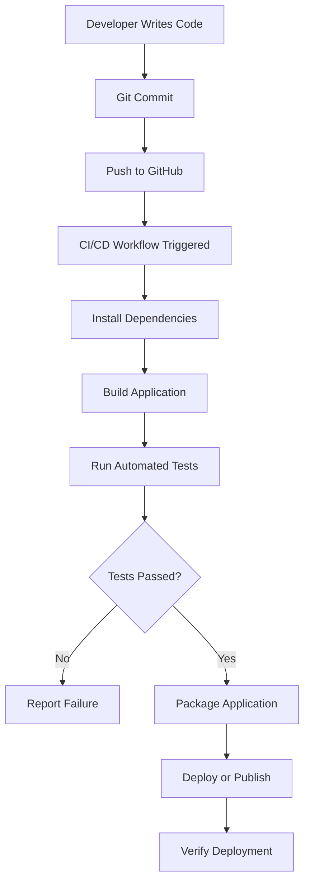

# 🚀 CI/CD Pipeline Workflow

A hands-on project exploring **Continuous Integration (CI) and Continuous Delivery/Deployment (CD)** to automate software development workflows, improve code quality, and streamline application delivery.

## 📌 Project Overview

CI/CD is an essential DevOps practice that helps developers automate repetitive tasks throughout the software development lifecycle.

This project focuses on understanding how source code changes can trigger automated workflows for building, testing, validating, and preparing applications for deployment.

By using version control and workflow automation, developers can detect errors earlier and deliver software more reliably.

## ✨ Key Features

- 🔄 **Continuous Integration** — Automatically validate code changes.
- 🧪 **Automated Testing** — Run tests to identify errors early.
- ⚙️ **Workflow Automation** — Execute predefined tasks through pipeline workflows.
- 📦 **Build Automation** — Automate application build steps.
- 🚀 **Deployment Automation** — Explore automated application delivery.
- 🔍 **Error Detection** — Identify workflow failures through execution logs.
- 🔧 **Version Control Integration** — Manage source code changes using Git and GitHub.

*The exact features depend on the workflow configuration and scripts present in this repository.*

## 🔄 CI/CD Workflow



### Workflow Explanation

1. **Code Development:** Developers create or modify application code.
2. **Version Control:** Changes are committed and pushed to GitHub.
3. **Workflow Trigger:** A configured pipeline starts automatically or manually.
4. **Build:** Required dependencies are installed and the application is built.
5. **Testing:** Automated checks validate the application.
6. **Validation:** Failed checks stop the workflow; successful checks proceed.
7. **Delivery:** The application is packaged, published, or deployed when configured.

## 🛠️ Technologies

- Git
- GitHub
- GitHub Actions
- YAML workflow configuration
- Automated testing tools
- Build and deployment tools, depending on the implementation

GitHub Actions supports automated workflows triggered by events such as pushes and pull requests, making it suitable for implementing CI/CD pipelines. <Cite refs={["turn416009search0","turn416009search3"]}/>

## 📂 Repository Structure

```text
CICD_Pipeline_Workflow/
│
├── .github/
│   └── workflows/
│       └── workflow.yml
├── src/                 # Application source code, if applicable
├── tests/               # Automated tests, if applicable
├── requirements.txt     # Dependencies, if applicable
└── README.md
```

*This is an illustrative structure. Update it to match the actual files in your repository.*

## ⚙️ Getting Started

### 1. Clone the repository

```bash
git clone https://github.com/dhilleswar07/CICD_Pipeline_Workflow.git
```

### 2. Navigate to the project directory

```bash
cd CICD_Pipeline_Workflow
```

### 3. Review the workflow configuration

